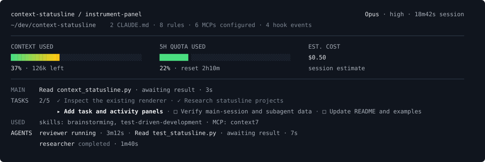

# Context Statusline

An opinionated, wide statusline for Claude Code. Keep the current task, main and delegated tool activity, configuration, context, quota and estimated cost in view. One layout: bright current work, quiet supporting detail, and color reserved for meters and attention.



*Generated from synthetic inputs by the actual renderer. The main footer and native agent panel are shown together for reference; Claude controls their placement.*

## Install

Requires **Python 3.9+** (the `python3` that ships with macOS works), Bash, and Claude Code. No `jq`, pip packages, daemon, API keys or network calls are needed at runtime. macOS and Linux are supported. For the Codex build, see [Codex](#codex).

```bash
git clone https://github.com/Esk3nder/context-statusline.git ~/.claude/context-statusline
python3 ~/.claude/context-statusline/install_claude.py --dry-run   # show the change
python3 ~/.claude/context-statusline/install_claude.py             # apply it
```

The installer adds `statusLine` and `subagentStatusLine` entries for this checkout to `~/.claude/settings.json` (or `$CLAUDE_CONFIG_DIR/settings.json`). It backs up a file it changes and keeps every other setting and hook. It refuses to replace another tool's statusline unless you add `--replace`. Add `--observers` for the [activity observers](#optional-activity-observers). `--uninstall` removes only the entries this checkout added. Running it again changes nothing.

Keep the checkout where you cloned it: the settings point at its `context-bar.sh`, which needs `context_statusline.py`, `activity.py` and `session_snapshot.py` beside it.

To merge by hand instead, `~/.claude/context-statusline/context-bar.sh --settings` prints the same entries and **does not edit your settings**. Back up `~/.claude/settings.json`, then merge the generated `statusLine` and `subagentStatusLine` entries into it. A minimal example, without activity observers:

```json
{
  "statusLine": {
    "type": "command",
    "command": "~/.claude/context-statusline/context-bar.sh",
    "refreshInterval": 5
  },
  "subagentStatusLine": {
    "type": "command",
    "command": "~/.claude/context-statusline/context-bar.sh --subagents"
  }
}
```

Claude reloads saved settings. Keep any unrelated settings and hooks. If another application manages your statusline, configure the replacement there or it may overwrite this change.

### Optional activity observers

To add main/subagent tool targets, observed skill/MCP usage and legacy to-do tracking, run `install_claude.py --observers`. By hand, append the hook groups printed by `--settings` to the corresponding arrays in your existing `hooks` object. **Do not replace existing hook arrays.** The generated commands record metadata only; they never allow, deny or block a tool call.

The observers cover tool requests/results/failures, permission events, subagent start/stop, compaction completion and session end. They retain IDs, timestamps, tool/event names, sanitized file basenames for known file tools, successful skill/MCP names, and confirmed legacy `TodoWrite` titles/statuses in a private local SQLite cache. They never store commands, file contents, search patterns, raw tool inputs/results, task descriptions, prompts, transcripts, compaction summaries or credentials. No transcript files are opened. Records expire after 24 hours, are pruned on the next observer write, and are removed for a session on `SessionEnd`.

Default cache: `~/.cache/context-statusline/activity.sqlite3`. `CONTEXT_STATUSLINE_STATE_DIR` can select another private directory. The directory must be owned by you with mode `0700`; database files must have mode `0600`. Symlinks are refused. Observer errors fail open and emit no hook decisions. A 200 ms SQLite lock budget keeps hooks bounded; observations are best effort under extreme writer contention.

Native task IDs are matched to hook `agent_id` values **only on exact equality**. If a host version uses different IDs, the row still shows native state, but activity details are omitted. No correlation by name or role is attempted.

## What the display means

- **Context:** the supplied percentage used, plus remaining tokens calculated from that percentage and the supplied context-window size. This is nominal capacity, not a quality score or a prediction of compaction.
- **Quota:** the more-used available five-hour or seven-day account window. Expired windows are ignored. API accounts or new sessions may not supply a window; the display says unavailable.
- **Cost:** Claude's supplied `cost.total_cost_usd`, labeled as a session estimate. It is not recalculated from token counts or presented as a bill. This tool does not split main-agent and delegated costs or make an independent claim about their inclusion.
- **Agents:** Claude's reported state. `completed` is not verified success. Running elapsed time comes from native `startTime`; completed duration appears only with a matching observed stop event.
- **Session:** `cost.total_duration_ms`, displayed in the header as elapsed wall time including idle. Missing/invalid duration is omitted.
- **Configuration:** discovered `CLAUDE.md`/`CLAUDE.local.md` files, `.claude/rules/*.md` files (including nested directories), configured MCP names, and hook event categories from known user and project/ancestor config locations. Counts deduplicate physical files and MCP names and apply explicit disabled MCP entries. These are discovered configuration counts, not a claim that files are loaded or servers connected. Managed/plugin configuration is not comprehensively enumerated.
- **Used:** successful skill and MCP invocations observed in this session, including matching child events. Installed/available skills are not presented as used.
- **Activity:** time since the observer received an event. `Read main.py · awaiting result` means the observer has a request without a matching result. The displayed time is the age of that request. It does not prove the tool is executing or stalled. A quiet tool does not trigger an inactivity warning.

The agent panel has its own documented `subagentStatusLine` JSONL interface; it is not part of the main footer's stdin payload. Native `agentType` requires Claude Code **2.1.293+**; older payloads fall back to a supplied name. Keep Claude current for both statusline surfaces.

## Claude’s task list

The checklist reads `~/.claude/tasks/<session_id>/*.json` on each render. `CLAUDE_CONFIG_DIR` changes the config root and `CLAUDE_CODE_TASK_LIST_ID` selects a named shared list, matching Claude’s documented task directory. Tasks survive restarts/compaction because this reads their current files; updates and deletions are reflected on the next repaint. An existing empty native list clears the display and takes precedence over legacy observer data.

The directory is documented; individual JSON records are a **version-sensitive adapter**, validated as `{id, subject, status}` with `pending`, `in_progress` or `completed` status. Unsupported, malformed or unreadable records produce `Task list incomplete`; no IDs are guessed. If no native list exists, successful `PostToolUse` events for main-session `TodoWrite` provide a legacy fallback. Rejected or unreadable native lists report incomplete data instead of showing cached legacy tasks. Child task lists never enter the main checklist. Task-tool availability depends on the host/model; this package does not enable tools or manufacture a list.

The whole supported list flows across the width: completed items recede, the current task is bright/bold, and pending items remain readable. Long titles wrap. It is display-only, with no layout modes or editable checkboxes. Safety bounds are 256 task files, 64 KiB per JSON file, 512 characters per title and 2,000 directory entries. Incomplete/bounded data is disclosed. Native task files and descriptions are never copied into our cache; only titles/statuses enter the display/diagnostics. Symlinked task roots/lists/files and traversal in list IDs are refused.

Configuration discovery also has a 2,000-entry rule budget, 32-ancestor limit and 1 MiB configuration JSON limit (task files remain capped at 64 KiB). Symlinked rule directories are skipped and partial scans are disclosed. It never executes configuration, follows arbitrary imports or prints credential/configuration values.

## Conditional notices

Context usage at 85% and quota usage at 90% get attention rows. These are display thresholds, not assumed compaction thresholds. Recent observer events can show `Approval requested`, `Tool failure reported`, `Permission denied`, or a temporary compaction notice. Event notices expire after 60 seconds; subsequent matching tool-result events clear approval-request metadata.

A permission request is a historical event, not proof a dialog is still waiting. Claude can temporarily hide the statusline during permission prompts. The observer never changes permissions or interprets arbitrary command output as test results. Native `failed`/`killed` agent states are displayed directly.

There are no default sparklines, session-duration instrument, healthy badges, guessed ETAs or memory-loss scores. The old optional `contextDisplay.compactionThreshold` scaling is no longer used; percentages consistently mean the supplied actual usage.

## Diagnostics and plain output

Each mode reads its documented JSON input on stdin:

```bash
COLUMNS=100 ./context-bar.sh --plain < tests/fixtures/session.json
./context-bar.sh --subagents --plain < tests/fixtures/subagents.json
./context-bar.sh --diagnostics < tests/fixtures/session.json
```

`--plain` or `NO_COLOR` disables ANSI colors. `--ascii` replaces meter glyphs and non-ASCII text for limited fonts. Width comes from host `COLUMNS` less four cells for Claude's footer spacing, or native subagent `columns`; invalid values fall back to 80. All text uses your terminal's own foreground (plain, faint or bold), so it reads on light and dark themes. Fixed colors mark only meter fills and the `!` marker of attention notices; they are mid tones that keep at least 3:1 contrast on white and near-black backgrounds. The same information order reflows as width shrinks. Checklist/activity text wraps by terminal cells without dropping supported titles; long identity text may be clipped to preserve the model header. Native agents keep one host-owned row per agent, wrapping their own content when necessary. Ambiguous-width characters can vary with terminal font/settings; use ASCII when needed.

Diagnostics expose normalized metrics, observer evidence, used capability names and the local task/configuration snapshot. Task titles and file basenames can be private project information; inspect before sharing diagnostics. Context-runway and quota-exhaustion forecasts remain `null`: this release does not collect a validated rate history or know the next compaction threshold. Missing data is not rendered as a confident zero. Cache details appear only when supplied.

## Codex

The shared wide design runs **inside our patched Codex CLI**, built from the upstream release commit pinned in `codex/upstream.json`. No new terminal, pane arrangement or upstream extension approval is needed. Stock Codex's `/statusline` picker still supports only its own built-in fields; it does not provide this renderer bridge. This does not customize the Codex desktop app.

### Codex quick start

1. Get a bundle for your computer. The **Native Codex bundle** workflow builds one per platform. Download the newest successful run's artifact (this needs a GitHub sign-in, and artifacts expire after the workflow's retention period):

   ```bash
   run=$(gh run list --repo Esk3nder/context-statusline --workflow codex-native.yml --status success --limit 1 --json databaseId --jq '.[0].databaseId')
   gh api "repos/Esk3nder/context-statusline/actions/runs/$run/artifacts" --jq '.artifacts[].name'   # one per OS and CPU
   gh run download "$run" --repo Esk3nder/context-statusline --name NAME-FROM-THAT-LIST --dir codex-statusline-bundle
   ```

   Or [build one locally](#build-from-source).
2. Install it from your checkout of this repository: `python3 install_codex.py codex-statusline-bundle`. The installer prints the launcher path and any step still missing, such as adding `~/.local/bin` to your PATH.
3. On macOS, install official Codex at the version the bundle was built from. The installer names it and prints the command, for example `npm install -g @openai/codex@<version>`. Homebrew's `codex` cask also works when it is at that version.
4. Run `codex-statusline`.

Python **3.9+** must be available on the target computer. Bundles contain the patched Codex binary, its canonical helper/ripgrep layout, the shared renderer, upstream license/notices and a SHA-256 file manifest. Artifact checksums verify integrity, not the publisher's identity; use a bundle from a build/source you trust.

```bash
python3 install_codex.py /path/to/codex-statusline-bundle
~/.local/bin/codex-statusline
```

On Windows, use `python` and run `%USERPROFILE%\.local\bin\codex-statusline.cmd`. Add that `bin` directory to your PATH if needed. Setup installs immutable versioned bundles under `~/.local/lib/context-statusline/versions/` and creates only the named `codex-statusline` launcher. It preserves stock `codex`, auth, existing hooks and Auto-managed status settings. It refuses edited/unowned launchers, unsafe bundle paths, symlinks in managed locations and checksum mismatches. Global Codex configuration and credentials are not copied or rewritten.

On macOS, official Codex must be on PATH as `codex`, at the exact upstream version recorded in the bundle's `manifest.json`. An npm install works: the launcher follows npm's Node wrapper to the signed binary inside the package. The launcher verifies the OpenAI signature and the version before starting a local session; when either check fails, the message gives the install command. Official Codex runs the agent and authenticated MCP integrations; our patched TUI connects through a private Unix socket and renders the panel in the same terminal. The statusline renderer has no credential API. This avoids introducing our unsigned executable as a new MCP Keychain reader. Existing macOS access rules still apply to official Codex; we do not grant access or suppress its legitimate authentication prompts.

Each local macOS launch owns one official app-server child, with no persistent service or TCP listener. The launcher cleans up that process group when the UI exits, including interrupt, hangup, terminate and quit signals. Startup failure stops the launch; the UI never falls back to its unsigned embedded backend. Every Codex subcommand except `resume` and `fork` delegates to official Codex; the launcher asks the bundled binary which words are subcommands, so new upstream commands need no launcher change. Explicit `--remote` connects the custom UI to the requested server without starting a local backend. Local named `--profile` selection is currently refused because the pinned app-server does not expose the same profile selector; use official `codex --profile NAME` for those sessions. Linux and Windows keep the bundled embedded backend. Other CLI arguments are forwarded to the UI, with explicit config/feature overrides and working-directory selection also forwarded to the local macOS backend.

```bash
python3 install_codex.py --rollback
python3 install_codex.py --uninstall
```

The installer checks the bundle OS/CPU, the panel runtime files, agreement with the canonical package metadata and every file checksum before activation. Upstream's packager validates the Codex package layout when the bundle is built.

Rollback activates the preceding verified bundle. Uninstall removes the owned launcher and retains bundles for recovery; it never removes stock Codex. A custom `--prefix` works with all three installer operations.

Native context uses the latest active context count, not cumulative session tokens. Quota labels reflect the actual window duration. The plan/checklist comes from native plan updates. Main/known-child tool calls are correlated by thread and item IDs; no shell commands, arguments, results or agent messages go to the renderer. Subagent states are the latest supplied native observations, not inferred progress. Supplied costs are **direct-thread estimates**; elapsed time is explicitly **since attachment**. Missing cost/config data stays unavailable or is omitted. Only known configured MCP counts are currently supplied; instruction/rule/hook/skill counts are omitted when unavailable. Codex never reads Claude task files, configuration or observer state.

The TUI patch is opt-in through `CODEX_STATUSLINE_COMMAND`, a JSON array of executable/argv entries set by the launcher. It uses no shell expansion. The command is validated once at startup; a malformed value is a startup error, not a silent no-panel. At most one renderer runs per widget, at most twice per second, with a 2 s timeout, 1 MiB input cap and 64 KiB output cap. Native text labels are limited to 512 characters before crossing the process boundary. Unix process groups and Windows Job Objects clean up renderer descendants on timeout, error and normal exit. Output is converted into styled cells with terminal control sequences removed; tabs expand to 8-column stops. A 64-row transport bound is disclosed when clipping, and the panel never takes more than a third of the screen. A renderer failure or timeout keeps the last good output on screen; renderer errors leave native Codex usable; dialogs and input take layout priority. Resumed threads rebuild the used-MCP and known-agent sets from history. We do not alter the backend, model context, permissions, approval behavior or agent tools.

### Build from source

Install [rustup](https://rustup.rs) and the native build dependencies upstream Codex needs (the Linux list is in `.github/workflows/codex-native.yml`). The pinned source declares its own Rust toolchain in `codex-rs/rust-toolchain.toml`. Then:

```bash
python3 codex/build.py --source ~/src/codex-statusline-source --check        # fetch and patch the pinned commit
(cd ~/src/codex-statusline-source/codex-rs && rustup toolchain install)      # the toolchain that source declares
python3 codex/build.py --source ~/src/codex-statusline-source --output ~/src/codex-statusline-bundle
```

Inside `codex-rs`, `rustc --version` must show the channel that `rust-toolchain.toml` declares. If it shows another version, a non-rustup Rust (for example Homebrew's `rust` formula) is ahead of rustup's proxies on PATH; put rustup's `bin` directory first.

`codex/upstream.json` pins the upstream commit, feature-patch checksum and resulting source-file checksums; it holds no version numbers. The Codex version is read from the pinned source's `Cargo.toml`, and the bundle version is that version plus a digest of our patch and runtime files, so every change gets a new version without a hand-edited counter. After changing the TUI source in a checkout of the pinned revision, `python3 codex/export_patch.py --source /path/to/checkout` regenerates the patch and both checksum sets. The build verifies/applies only our TUI patch, then hands compilation, helper binaries, stripping and layout validation to upstream's own packager (`scripts/build_codex_package.py`) and adds the panel runtime. It builds for the build host's Rust target; upstream's own Linux releases are static musl builds that need upstream's musl toolchain setup. Upstream release tags retain development workspace versions in Cargo.lock; the script normalizes those workspace version fields without changing dependency revisions. `--check` verifies/prepares source without compiling; `--profile dev` makes a local development bundle. CI builds native macOS ARM64, Linux x86-64 and Windows x86-64 artifacts. Other architectures need separate builds. These are test artifacts, not notarized public macOS releases; signing/notarization and a stable release channel remain distribution work.

Our maintenance is the renderer/adapters, bounded TUI patch and launcher. The official app-server interface is experimental, so each upgrade must verify the local connection and credential boundary as well as the panel. For an upstream update: select a new pinned release, apply the patch, review any conflict, run adapter/installer/launcher/TUI tests, build each supported platform and publish a new bundle only after validation. A failed upgrade keeps the previous installed version available. Stock Codex updates do not update our independently installed bundle; on macOS the official backend must match the UI's pinned upstream version. The launcher disables the UI's official startup update check for this invocation and directs `codex-statusline update` to our bundle installer.

## Upgrade and rollback

The Bash entry-point path remains the same, but it now delegates to Python and needs the Python files beside it. Existing single-file `curl` installations must switch to the full checkout. To update, run `git pull` in that checkout; the settings keep pointing at it. To undo configuration changes, run `python3 install_claude.py --uninstall`, or restore the `.bak` backup it wrote next to your settings. Other settings and hooks stay intact.

## Develop

```bash
python3 -m unittest discover -s tests -v
bash -n context-bar.sh
git ls-files -z '*.py' | xargs -0 python3 -m py_compile
python3 docs/examples/render.py && git diff --exit-code -- docs/examples
```

These are the same checks CI runs (`.github/workflows/test.yml`). Agents: see [AGENTS.md](AGENTS.md).

Tests cover input validation, supplied cost accounting, missing/zero values, Unicode width and terminal controls, native JSONL, concurrent observer writes, session isolation, expiry and private storage. The fixture inputs contain no real session data. Example generation runs the same rendering functions as the executable.

Sources: [Claude statusline payload](https://code.claude.com/docs/en/statusline#available-data), [native subagent rows](https://code.claude.com/docs/en/statusline#subagent-status-lines), [hook events](https://code.claude.com/docs/en/hooks#hook-events), [task persistence](https://code.claude.com/docs/en/interactive-mode#task-list), and [Codex footer settings](https://learn.chatgpt.com/docs/developer-commands#configure-footer-items-with-statusline).

MIT licensed.
